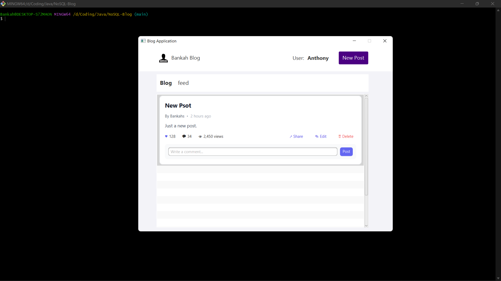

# Smart Blogging Platform – Database Fundamentals Project

## Overview
The Smart Blogging Platform is a data-driven blogging system designed to demonstrate strong understanding of **database design, normalization, performance optimization, and JavaFX–database integration**.

The project focuses on building a robust **data layer and persistence logic** that supports core blogging operations such as post creation, comment management, tagging, searching, sorting, and performance analytics.

This project emphasizes **engineering correctness, scalability, and performance**, rather than UI complexity.

---

## Homepage Screenshot

---

## Author

**Anthony Bekoe Bankah**
Smart Blogging Platform – Database Fundamentals
